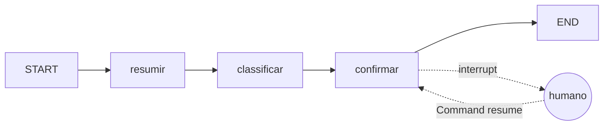

# Grafo de triagem de artigos da revisão sistemática

Grafo em LangGraph (Python) com três nós e um interrupt: resume o abstract de um artigo, classifica em um dos eixos da revisão e pede a confirmação de um humano antes de registrar o eixo final. 

## Como funciona



| Nó | O que faz | Campos que escreve |
|---|---|---|
| `resumir` | resume o abstract em português, em até três frases | `resumo` |
| `classificar` | escolhe um eixo a partir do resumo, com saída estruturada | `eixo`, `justificativa` |
| `confirmar` | pausa com `interrupt()` e espera a decisão humana | `decisao_humana`, `eixo_final` |

O `eixo` guarda a sugestão do modelo e o `eixo_final` guarda a decisão humana. Quando o humano responde `ok`, a decisão é `aprovado` e o eixo final é o sugerido. Quando responde com outro eixo, a decisão é `corrigido` e o eixo final é o informado. Assim fica registrado quando o humano discordou do modelo. Se a resposta não for `ok` nem um dos eixos da lista, o nó pausa de novo e repete a pergunta, então um eixo inexistente ou digitado errado nunca vira `eixo_final`.

## Eixos

- **eixo 1**: AI4SE com SDD para orquestração de agentes, incluindo orquestração bidirecional
- **eixo 2**: AI4SE para refatoração de sistemas legados com grafos de conhecimento
- **eixo 3**: métricas de produtividade de agentes AI4SE (incluindo LLMOps) e benchmarks de agentes

## Como rodar

```bash
python3 -m venv .venv
source .venv/bin/activate
pip install langgraph langchain-google-genai pydantic
export GOOGLE_API_KEY="sua-chave"
python grafo.py
```

A chave fica só na variável de ambiente, nunca no código.

## Exemplo de execução

Abstract de teste (em inglês) sobre refatoração de um sistema COBOL com grafo de conhecimento:

```
Parado antes de: ('confirmar',)

Resumo: Sistemas legados acumulam débito técnico que torna a refatoração custosa e arriscada. Para resolver isso, propõe-se uma abordagem em que agentes baseados em LLM constroem um grafo de conhecimento da base de código para planejar refatorações incrementais. Em um estudo de caso industrial com um sistema COBOL de 400 mil linhas, a abordagem reduziu o tempo para identificar candidatos à refatoração em 60%.
Eixo sugerido: eixo 2
Justificativa: O artigo aborda a refatoração de sistemas legados utilizando agentes baseados em LLM com o auxílio de grafos de conhecimento construídos a partir da base de código.

Digite 'ok' ou o eixo correto: ok

Decisão: aprovado | eixo final: eixo 2
```

A primeira chamada ao grafo roda até o `interrupt` e para. `get_state(config).next` mostra o nó em que ele está parado e o valor do interrupt traz o que é mostrado ao humano. A segunda chamada retoma com a resposta.

## Decisões

- **Checkpointer e thread_id.** O grafo é compilado com `InMemorySaver`. É ele que guarda o estado no momento do interrupt; sem checkpointer não há de onde retomar. A retomada usa `Command(resume=resposta)` com o mesmo `thread_id` da primeira chamada (`artigo-1`).
- **O nó pausado roda de novo na retomada.** Ao retomar, `confirmar` executa desde o início e, dessa vez, o `interrupt()` devolve a resposta humana em vez de pausar. Por isso não há nada antes do interrupt que não possa rodar duas vezes. A validação usa um laço com mais de um `interrupt()` no mesmo nó: na retomada, o LangGraph entrega as respostas anteriores aos interrupts já respondidos, na ordem, e só pausa no primeiro que ainda não tem resposta. Por isso o `__main__` retoma em laço enquanto `get_state(config).next` não estiver vazio. Os nós anteriores já terminaram e estão no checkpoint, então o LLM não é chamado de novo.
- **Saída estruturada.** A classificação usa um schema Pydantic (`Classificacao`) com `Literal["eixo 1", "eixo 2", "eixo 3"]`, para o modelo não inventar um eixo fora da lista. O dicionário `EIXOS` e o `Literal` precisam mudar juntos se os eixos mudarem.
- **Resposta em blocos.** Os modelos Gemini mais novos podem devolver o conteúdo como uma lista de blocos, incluindo uma assinatura interna do raciocínio. O nó `resumir` junta só os blocos de texto, para o resumo (e o prompt do classificador) não carregar esse lixo.
- **Modelo reserva.** Principal `gemini-3.7-flash`, reserva `gemini-3.5-flash-lite`, ligados por `with_fallbacks`, com `timeout=60` e `max_retries=3`. O classificador tem a própria cadeia, com `with_structured_output` aplicado ao principal e ao reserva, para que a reserva também devolva um objeto `Classificacao` e não texto solto. Durante os testes o Gemini retornou 503 por alta demanda e chegou a derrubar a conexão; com a reserva o grafo continua funcionando. Os nomes têm versão fixa, e não `latest`, para a classificação ser reproduzível.
- **Temperatura.** O principal usa `temperature=0`. O reserva não aceita esse parâmetro (usa amostragem fixa), então as respostas dele podem variar entre execuções.
